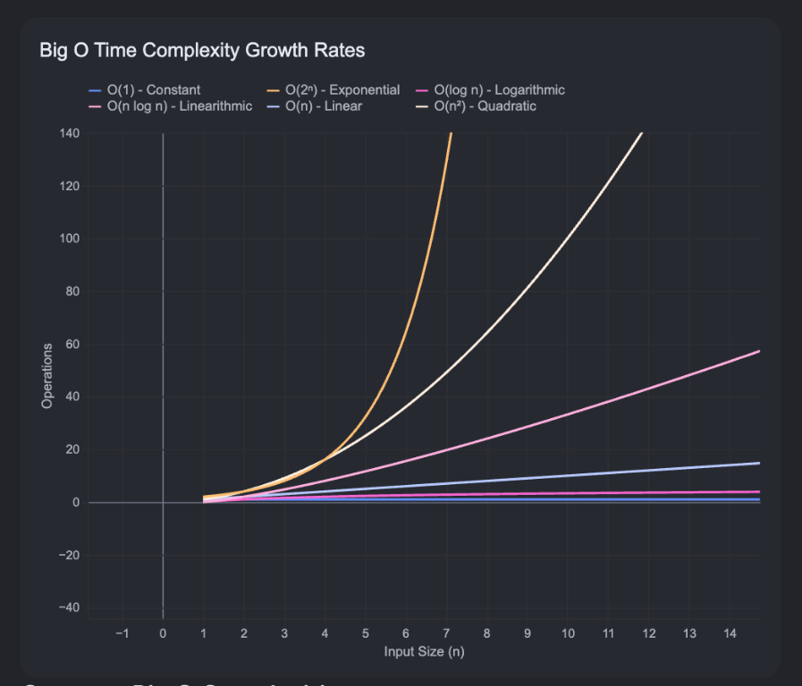

# Foundations

Build the JavaScript and complexity-analysis skills used throughout the roadmap.

**Roadmap days:** 1–2

## Focus

- JavaScript for DSA and useful array methods
- Big-O, time complexity, and space complexity

## Big O notation

Big O describes how an algorithm's time or extra memory grows as the input size
`n` increases. It focuses on the growth pattern, not seconds on a particular
computer. It is often used to describe worst-case performance.

| Complexity | Growth | Example |
| --- | --- | --- |
| `O(1)` | Constant | Read an array element by index |
| `O(log n)` | Logarithmic | Binary search in a sorted array |
| `O(n)` | Linear | Scan an array to find its largest value |
| `O(n log n)` | Linearithmic | Merge sort |
| `O(n^2)` | Quadratic | Compare every pair of items |
| `O(2^n)` | Exponential | Generate every subset |
| `O(n!)` | Factorial | Generate every permutation |

When simplifying:

- Drop constant factors: `O(3n + 20)` becomes `O(n)`.
- Keep only the fastest-growing term: `O(n^2 + 5n + 10)` becomes `O(n^2)`.

Time complexity counts work; space complexity describes extra memory used.

## Problem tracker

| Problem | Pattern | Status |
| --- | --- | --- |
| _No problems added yet_ | — | — |

When adding a problem, copy the [problem template](../_templates/problem/README.md)
and its JavaScript files into a new problem folder here.
