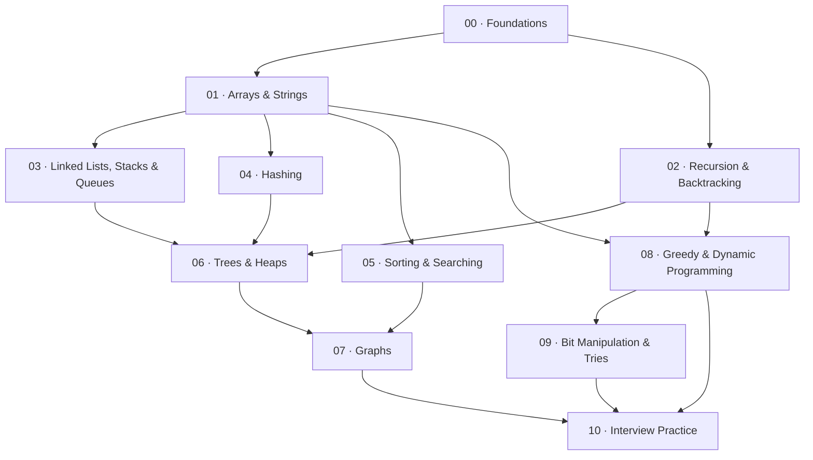

# 📚 DSA Learning – JavaScript Interview Plan

This repository contains a **Data Structures & Algorithms (DSA) study plan**
focused on **JavaScript** and **technical interviews**.

---

## 🗺️ Learning Path

The flowchart shows the recommended topic dependencies. The 30-day schedule below
is the day-by-day plan; use the topic pages to find an overview and start tracking
practice problems.

### Topic pages

- [00 · Foundations](./00-foundations/)
- [01 · Arrays & Strings](./01-arrays-and-strings/)
- [02 · Recursion & Backtracking](./02-recursion-and-backtracking/)
- [03 · Linked Lists, Stacks & Queues](./03-linked-lists-stacks-and-queues/)
- [04 · Hashing](./04-hashing/)
- [05 · Sorting & Searching](./05-sorting-and-searching/)
- [06 · Trees & Heaps](./06-trees-and-heaps/)
- [07 · Graphs](./07-graphs/)
- [08 · Greedy & Dynamic Programming](./08-greedy-and-dynamic-programming/)
- [09 · Bit Manipulation & Tries](./09-bit-manipulation-and-tries/)
- [10 · Interview Practice](./10-interview-practice/)

To add a problem, create a numbered folder (for example, `01-problem-name/`)
under the relevant topic. Copy the [problem template](_templates/problem/README.md),
its [`solution.js`](_templates/problem/solution.js), and
[`solution.test.js`](_templates/problem/solution.test.js) into that folder.

## 🗓️ DSA Roadmap

### 1: Foundations + Arrays & Strings

- Day 1: [JavaScript for DSA, Array methods, Big-O basics](./00-foundations/)
- Day 2: [Time & Space Complexity](./00-foundations/)
- Day 3: [Arrays (Traversal, Prefix Sum)](./01-arrays-and-strings/)
- Day 4: [Sliding Window & Two Pointers](./01-arrays-and-strings/)
- Day 5: [Strings](./01-arrays-and-strings/) & [Frequency Counting](./04-hashing/)
- Day 6: [Recursion Basics](./02-recursion-and-backtracking/)
- Day 7: [Weekly Revision & Mock Practice](./10-interview-practice/)

---

### 2: Linked List, Stack & Queue

- Day 8: [Linked List Basics](./03-linked-lists-stacks-and-queues/)
- Day 9: [Linked List Advanced (Cycle, Merge)](./03-linked-lists-stacks-and-queues/)
- Day 10: [Stack (Valid Parentheses, NGE)](./03-linked-lists-stacks-and-queues/)
- Day 11: [Queue & Deque](./03-linked-lists-stacks-and-queues/)
- Day 12: [Hashing (Map & Set)](./04-hashing/)
- Day 13: [Sorting Algorithms](./05-sorting-and-searching/)
- Day 14: [Weekly Revision](./10-interview-practice/)

---

### 3: Trees & Graphs

- Day 15: [Binary Trees & DFS](./06-trees-and-heaps/)
- Day 16: [Binary Search Tree (BST)](./06-trees-and-heaps/)
- Day 17: [Heap & Priority Queue](./06-trees-and-heaps/)
- Day 18: [Graph Basics (BFS & DFS)](./07-graphs/)
- Day 19: [Graph Advanced (Cycle Detection)](./07-graphs/)
- Day 20: [Binary Search Patterns](./05-sorting-and-searching/)
- Day 21: [Weekly Revision](./10-interview-practice/)

---

### 4: Advanced Interview Topics

- Day 22: [Greedy Algorithms](./08-greedy-and-dynamic-programming/)
- Day 23: [Dynamic Programming (Basics)](./08-greedy-and-dynamic-programming/)
- Day 24: [Dynamic Programming (Advanced)](./08-greedy-and-dynamic-programming/)
- Day 25: [Backtracking](./02-recursion-and-backtracking/)
- Day 26: [Bit Manipulation](./09-bit-manipulation-and-tries/)
- Day 27: [Tries](./09-bit-manipulation-and-tries/)
- Day 28: [Interview Patterns](./10-interview-practice/)
- Day 29: [Mock Interviews](./10-interview-practice/)
- Day 30: [Final Revision](./10-interview-practice/)

---

## 🧠 Practice Platforms

- LeetCode
- HackerRank
- GeeksforGeeks
- CodeSignal

---

## 🎯 Goal

To build **strong DSA fundamentals** and be **interview-ready** using JavaScript.

Happy coding 🚀
